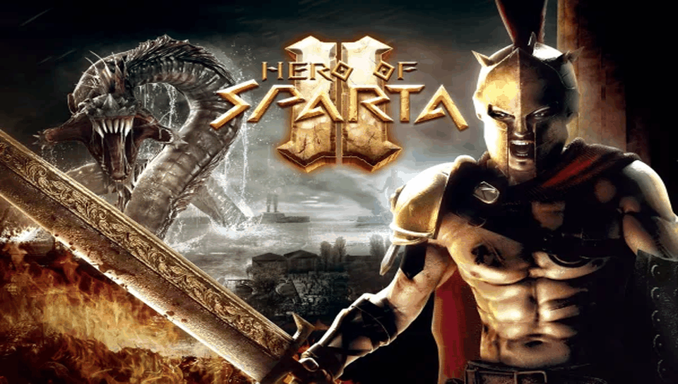

<h1 align="center">
  <br>
  Hero of Sparta II · PS Vita Port
</h1>

<p align="center">
  <a href="#-status--playability">Status & Playability</a> •
  <a href="#setup-instructions-for-players">How to install</a> •
  <a href="#controls">Controls</a> •
  <a href="#known-issues">Known Issues</a> •
  <a href="#build-instructions-for-developers">How to compile</a> •
  <a href="#credits--acknowledgments">Credits</a>
</p>

An unofficial, native **iOS-to-PS Vita wrapper port** of *Hero of Sparta II* (originally developed by **Gameloft**). There is no `.so` here: this port ships its own **Mach-O loader** that maps the official iOS ARM executable (`HOS2`, from the 1.0.2 IPA) into PS Vita RAM and replaces the Apple frameworks it uses (Foundation, UIKit, CoreGraphics, CoreAudio, MediaPlayer, OpenGL ES) with native implementations on top of **vitaGL**, **FFmpeg**, **FreeType** and the Vita system libraries.

---

## 🎮 Status & Playability

**Status: Playable (v1.0)**

The game boots on physical PlayStation Vita hardware, plays the intro trailer, and is playable from the title screen through gameplay with correct graphics and sound.

- [x] **Mach-O loader**: loads the iOS ARM executable at a fixed base (`MACHO_SLIDE = 0x98000000`), applies **39,357** rebase words (non-PIE image, including `-mdynamic-no-pic` literal pools and ARM switch jump tables in `__text`), resolves **1,930** dynamic imports / relocations (0 unimplemented), runs the **298** global constructors, and enters the game thread. *Verified on console.*
- [x] **Graphics**: GLES 1.x → **vitaGL** (`SOFTFP_ABI=1`). The game renders into a 320×480 framebuffer that is rotated onto the Vita's 960×544 screen. Menus, HUD and 3D levels render correctly. *Verified on console.*
- [x] **Fullscreen 16:9**: no black side bars. The 480×320 image is stretched to 960×544, so HUD, menus and cutscene letterboxing reach the screen edges, and touch input is mapped with the same stretch.
- [x] **Videos**: `HoS_trailer.m4v` plays with hardware H.264 decoding (`SceVideodec`) and AAC audio via FFmpeg; it can be skipped. *Verified on console.*
- [x] **Audio**: music and sound effects. *Verified on console.*
- [x] **Touch & Controls**: front touchscreen plus a full physical button mapping (see [Controls](#controls)). *Verified on console.*
- [x] **Hidden touch controls**: the on-screen joystick and action buttons are hidden (0% opacity) by default; **L + R** toggles them to 100%.
- [x] **Saves**: iOS `Documents/` is redirected to `ux0:data/heroofspartaii/saves/` (`savegame`, `savebackup`, `statistics0`, `saveachievements`, `savesettings`) and the files are written. Continue resumes from the last checkpoint (verified on console); every save read/write/delete is logged with a `[SAVE]` tag.
- [x] **Offline bypasses**: Gameloft Live, ads and network uploads are skipped by design.

---

## Disclaimer

**Hero of Sparta** is a registered trademark of **Gameloft**. The work presented in this repository is unofficial and is not produced, endorsed, or sanctioned by Gameloft or any affiliated entities.

This software does NOT contain original game code, binaries, copyrighted graphics, or game assets. The authors do not promote or condone piracy in any way. To play, you must provide your own legally obtained, **decrypted** copy of the iOS `.ipa`.

---

## Setup Instructions (For Players)

1. **CFW & Plugins**: PS Vita on Custom Firmware (**Enso 3.60 / 3.65** recommended) with `kubridge` under `*KERNEL` in `ur0:tai/config.txt`:
   ```ini
   *KERNEL
   ur0:tai/kubridge.skprx
   ```
2. **Shader Compiler**: `libshacccg.suprx` must be in `ur0:data/` (extract it with **ShaRKBR33D**).
3. **Game Files**: a decrypted **Hero of Sparta II 1.0.2** iOS `.ipa` (FairPlay `cryptid 0`). Open it as a ZIP and extract `Payload/HOS2.app/`.
4. **Copy to the Vita** (`ux0:data/heroofspartaii/`):
   ```
   ux0:data/heroofspartaii/
     game_app/      the contents of HOS2.app from the IPA, untouched (renamed to game_app)
     rebase.bin     generated from the executable (see "Build Instructions")
     controls.txt   created automatically — touch positions of the physical buttons
     saves/         created automatically — your save games
     logs/          created automatically — heroofspartaii_001.log … one per run
   ```
5. **Install VPK**: install `heroofspartaii.vpk` with VitaShell.

---

## Controls

Physical buttons are translated into touches on the game's own on-screen buttons. The touch points can be edited in `ux0:data/heroofspartaii/controls.txt`.

| Input | Action |
| :---: | :--- |
| **Front Touchscreen** | Full touch UI (menus, HUD) |
| **Left Stick / D-Pad** | Move (virtual joystick) |
| **Cross (✖)** | Attack |
| **Right Stick** | Directional attack (swipe on the attack button) |
| **Square (◼)** | Jump |
| **Triangle (▲)** | Defend |
| **Circle (●)** | Grab enemy / start finisher cutscene |
| **Start** | Shield button |
| **Select** | Pause menu |
| **L + R** | Show / hide the on-screen touch controls (hidden by default) |
| **Cross / Circle / Start** | Skip the trailer video |

---

## Known Issues

- **Slow start-up**: the game opens ~400 sound files at boot before the trailer starts.
- **Online features disabled**: Gameloft Live, ads and network uploads are bypassed by design.
- **Crash dumps** are written by the system to `ux0:data/` (not to the game folder).

---

## Build Instructions (For Developers)

### Prerequisites

- [VitaSDK](https://vitasdk.org/) (`$VITASDK`) with `vitaGL` (vendored), `vitashark`, `freetype`, `libpng`, `zlib` and FFmpeg (`avcodec`, `swresample`, `avutil`).
- CMake 3.14+, Python 3 (for the tools).
- The decrypted `HOS2.app` folder, linked as `game_app` in the repo root (never committed).

### Compilation Commands

```bash
git clone https://github.com/MetalSyntax/Hero-of-Sparta-II-vita.git
cd Hero-of-Sparta-II-vita
ln -s /path/to/Payload/HOS2.app game_app

# Stage the console data (copies the .app untouched + generates rebase.bin)
tools/stage_data.sh

# Build eboot.bin / heroofspartaii.vpk
cmake -S . -B build
cmake --build build
```

### Deploy & Debug (over VitaShell FTP)

```bash
python3 -I tools/deploy_data.py          # incremental upload of ux0_data/heroofspartaii/ (never touches saves/)
python3 -I tools/deploy_data.py --logs   # fetch logs and crash dumps into ./logs/
```

A crash PC in `0x98xxxxxx` minus `0x98000000` is the address in the Mach-O: inspect it with `python3 -I tools/annotate.py game_app/HOS2 <symbol>`. Architecture and progress notes: [`PORTING_PLAN.md`](PORTING_PLAN.md).

---

## ☕ Support My Work

This project is **free** and will stay free. If you enjoy it, a tip from **$1** helps me keep porting games to the PS Vita:

<p align="center">
  <a href="https://ko-fi.com/metalsyntax"></a>
</p>

- **Ko-fi:** [ko-fi.com/metalsyntax](https://ko-fi.com/metalsyntax)
- **PayPal:** [paypal.me/MetalSyntax](https://paypal.me/MetalSyntax)
- **Bitcoin (BTC):** `133HdCsaWxdjTfmwpgGVykByhNBV338uRc`

**Ko-fi supporters get:**
- **Early access** to new ports before their public release (test builds of upcoming projects).
- **Data preparation scripts and step-by-step guides** to set up your own game files for each new port.
- A say in which games I port next.

> Game files are never distributed. You always need your own legally obtained copy of the game.

---

## Credits & Acknowledgments

- **Hero of Sparta II** is intellectual property of **Gameloft**.
- **vitaGL** graphics library by [Rinnegatamante](https://github.com/Rinnegatamante/vitaGL).
- **kubridge** plugin by [Bythos](https://github.com/bythos14/kubridge).
- **FFmpeg**, **FreeType**, **libpng** and **zlib** projects.
- The **iOS Mach-O loader** is based on [`ios-loader-boilerplate`](https://github.com/MetalSyntax/ios-loader-boilerplate) and the [`Inotia2-vita`](https://github.com/MetalSyntax/Inotia2-vita) port.
- Special thanks to the PS Vita homebrew and porting community.
